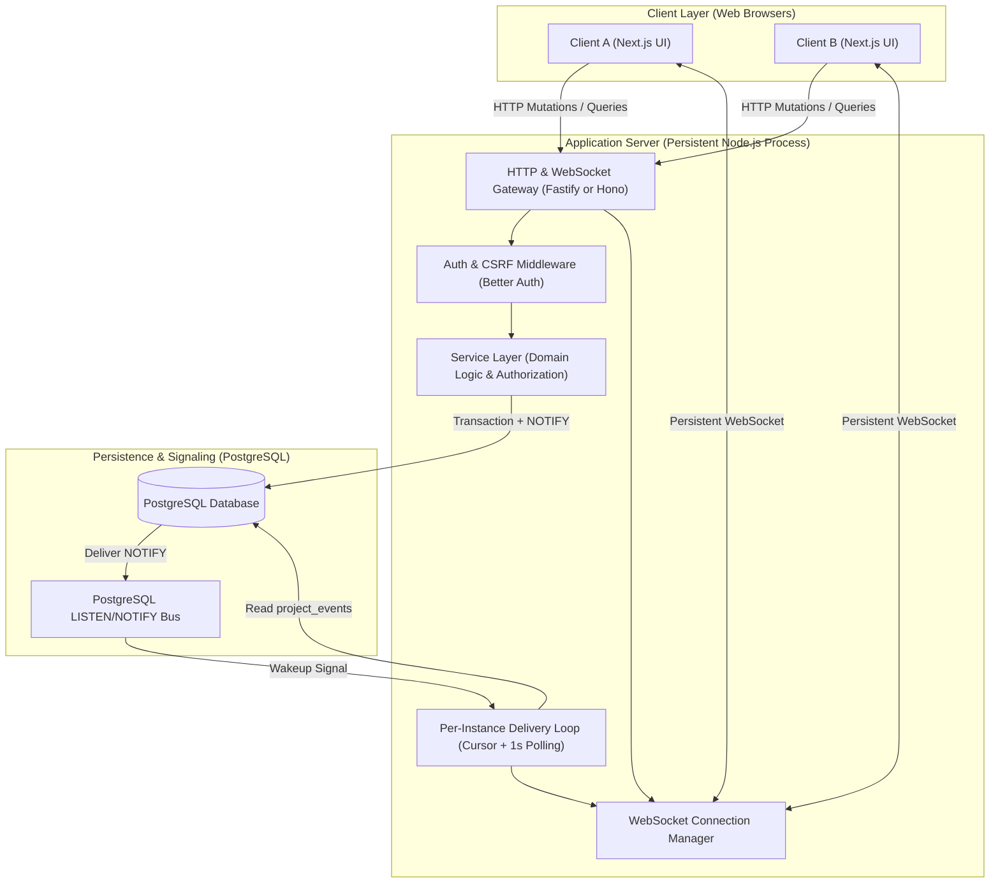
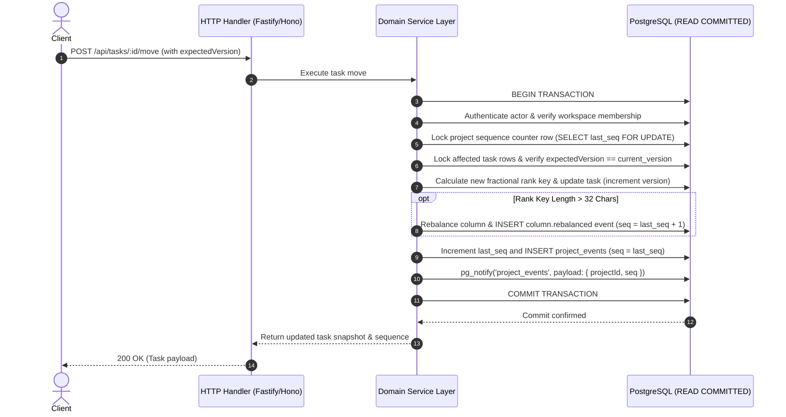
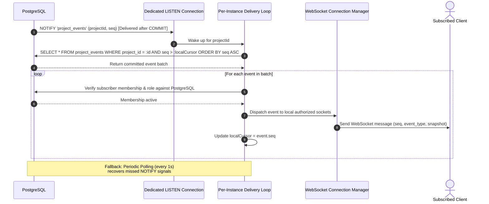
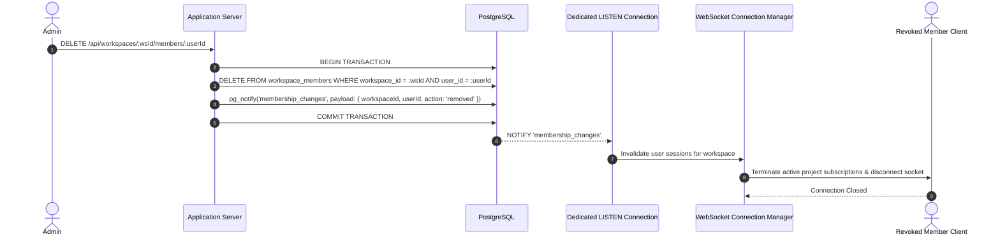

# SyncSpace — System Architecture

This document describes the architectural design, process boundaries, subsystem responsibilities, and data flows for the SyncSpace platform, based on [`SPECIFICATION.md`](SPECIFICATION.md).

---

## 1. High-Level Architecture

SyncSpace is architected as a **modular monolith** consisting of a decoupled Next.js frontend, a persistent Node.js backend server hosting both HTTP APIs and WebSockets, and a single PostgreSQL database acting as the authoritative state store.



---

## 2. Process Boundaries & Components

### 2.1 Frontend Client (Next.js, React, TypeScript)
- **Role:** Pure presentation and user interaction layer. Next.js is strictly the frontend; WebSockets and domain logic are **never** hosted in Next.js API routes or serverless lambdas.
- **Kanban Board:** Renders project columns and tasks ordered by fractional rank keys. Handles drag-and-drop operations with destination column, neighboring anchor tasks, and `expectedVersion`.
- **Optimistic UI with Rollback:** Applies local optimistic updates only when reversible. If the server returns `409 VERSION_CONFLICT` or an error, the client rolls back the optimistic UI, retains unsaved form input, and displays clear non-blocking feedback.
- **WebSocket State Machine:** Maintains connection status (`connected`, `reconnecting`, `offline`), tracks the latest contiguous applied sequence cursor (`lastAppliedSeq`), buffers out-of-order events, and triggers catch-up requests upon detecting sequence gaps.

### 2.2 HTTP & WebSocket Server (Node.js Process)
- **Framework:** Long-running Node.js process using Fastify or Hono.
- **Boundary Validation:** Enforces Zod schemas on every incoming request body, query parameter, and path variable.
- **Authentication & CSRF:** Integrates Better Auth. Uses secure, `HttpOnly` session cookies in production. Validates the `Origin` header and enforces CSRF tokens on all cookie-authenticated mutations.
- **WebSocket Gateway:**
  - Validates `Origin` header during handshake against an explicit allowlist.
  - Authenticates the user session prior to connection acceptance.
  - Manages subscription sets per client and per project.
  - Does **not** cache workspace membership; verifies membership against PostgreSQL directly before subscription or event dispatch.

### 2.3 Service Layer (Framework-Agnostic Domain Services)
- Encapsulates business logic across distinct service modules:
  - `WorkspaceService`: Workspace creation, settings, ownership transfer.
  - `MembershipService`: Member invitation, role demotion/promotion, member removal.
  - `ProjectService`: Project creation, renaming, archive, restore.
  - `ColumnService`: Column definitions, fixed statuses, column rebalancing.
  - `TaskService`: Task CRUD, moves, optimistic concurrency checks, archive, restore.
  - `CommentService`: Comment creation, soft deletion.
  - `SearchService`: Full-text search queries using PostgreSQL `tsvector` and GIN index.
- **Strict Authorization Rule:** Authorization is enforced in the service layer using the authenticated user ID and the target resource's workspace ID. Client-provided resource IDs are **never** trusted as proof of authorization.

### 2.4 Data Access Layer (Drizzle ORM & PostgreSQL Connections)
- **Unified Drizzle Schema & Migration Pipeline:** Both domain tables (`users`, `workspaces`, `tasks`, etc.) and Better Auth tables (`sessions`, `accounts`, `verifications`) are managed under a single unified Drizzle ORM schema and migration pipeline (`0000_futuristic_brood.sql`, `0001_auth_tables.sql`).
- **Primary Connection Pool:** Used for ordinary application queries, REST endpoints, and transactional domain mutations. Runs under PostgreSQL `READ COMMITTED` isolation.
- **Dedicated Listener Connection:** A dedicated, long-lived PostgreSQL connection reserved exclusively for `LISTEN` subscriptions (`project_events` and `membership_changes`). This connection bypasses transaction-level pooling proxies (e.g., PgBouncer transaction mode) because `LISTEN` is session-scoped.

### 2.5 Unified Project Event & Delivery Subsystem
- **Single Canonical Table:** `project_events` acts simultaneously as the audit log, catch-up replay feed, and real-time notification source.
- **No Outbox Table or Publication Flags:** The system maintains no per-event publication flags, no claim loops (`SKIP LOCKED`), and no separate outbox tables.
- **Per-Instance Delivery Engine:**
  - Maintains an in-memory delivery cursor (`local_last_delivered_seq`) per project for local connected sockets.
  - Woken up by PostgreSQL `NOTIFY` signals carrying `(project_id, seq)`.
  - Runs a fallback polling loop every 1 second querying active projects for sequences beyond the local cursor.
  - Dispatches events to locally connected, authorized WebSockets in ascending sequence order.

---

## 3. Core Architectural Workflows

### 3.1 Project Mutation & Co-Commit Transaction Flow

Every state-changing project mutation executes inside a single PostgreSQL transaction ensuring strict atomicity between the domain mutation and its durable event.



> [!IMPORTANT]
> If any step fails (e.g., version mismatch, constraint violation, or database error), the transaction is completely rolled back. No orphan `project_events` row is ever created, no sequence number is burned, and no `NOTIFY` signal is dispatched by PostgreSQL.

---

### 3.2 Real-Time Event Propagation & Per-Instance Delivery Flow

WebSockets operate under **at-least-once** delivery semantics. Notifications act as a lightweight wake-up trigger, while the database remains authoritative.



---

### 3.3 Reconnect & Catch-Up Workflow

When a client loses network connectivity, it uses a monotonic cursor to fetch missed events upon reconnecting, preventing lost updates without requiring full state reloads.

```mermaid
sequenceDiagram
    autonumber
    actor Client
    participant Server as HTTP & WS Gateway
    participant DB as PostgreSQL

    Note over Client: Network drops; Client reconnects with lastAppliedSeq = 42
    Client->>Server: Re-establish WebSocket connection & subscribe (projectId)
    Client->>Server: GET /api/projects/:projectId/changes?after=42&limit=50
    Server->>DB: Verify actor workspace membership
    Server->>DB: SELECT * FROM project_events WHERE project_id = :id AND seq > 42 ORDER BY seq ASC LIMIT 50
    DB-->>Server: Return events (43..65), nextCursor=65, hasMore=false, currentProjectSeq=65
    Server-->>Client: 200 OK (Events 43..65)
    loop For each catch-up event
        Client->>Client: Apply event sequentially to board state
        Client->>Client: Advance lastAppliedSeq = event.seq
    end
    Note over Client: Client is caught up; resumes live WebSocket event consumption
```

If the client detects a sequence gap in the live WebSocket stream (e.g., receives sequence 70 when expecting 66), it buffers incoming messages (up to a small bounded limit) and queries the catch-up endpoint to fill the gap before processing buffered events.

---

### 3.4 Membership Revocation & Socket Eviction Flow

Immediate revocation is enforced via a dedicated PostgreSQL channel without relying on stale in-memory permission caches.



---

## 4. Multi-Instance Scaling Model

While SyncSpace targets a single application instance for the v1 baseline, its architecture is fundamentally designed to support multi-instance deployments without introducing Redis:

1. **Independent Sockets:** Each application instance maintains its own set of connected client WebSockets.
2. **Shared Signaling:** All instances listen to the shared PostgreSQL notification channels (`project_events` and `membership_changes`) via dedicated long-lived database connections.
3. **Independent Delivery Cursors:** Every instance maintains its own in-memory delivery cursor per project. An event committed by Instance 1 emits a `NOTIFY` signal that wakes Instances 1, 2, and 3 simultaneously. Each instance queries PostgreSQL for events newer than its own local cursor and dispatches them to its locally connected clients.
4. **Independent Polling:** Each instance independently polls active subscribed projects every 1 second, guaranteeing recovery even if a specific instance's `LISTEN` connection experiences transient network packet loss.
5. **Direct Authorization:** Instances check user membership directly against PostgreSQL before delivering events; no distributed session or permission cache is required.

---

## 5. Deployment & Process Model

SyncSpace is deployed to hosting platforms supporting long-running persistent processes and managed PostgreSQL:

- **Target Platforms:** Railway, Render, or Fly.io with managed PostgreSQL. Serverless lambda platforms (e.g., Vercel Functions, AWS Lambda) are **incompatible** with the backend due to the need for persistent WebSocket connections, dedicated `LISTEN` sessions, and background polling loops.
- **Connection Management:**
  - One standard connection pool (sized appropriately for API traffic).
  - One dedicated, non-pooled connection for the PostgreSQL event listener.
- **Health & Readiness Endpoints:**
  - `GET /health` — Verifies process responsiveness and event loop latency.
  - `GET /ready` — Validates database pool connectivity and listener connection status.

