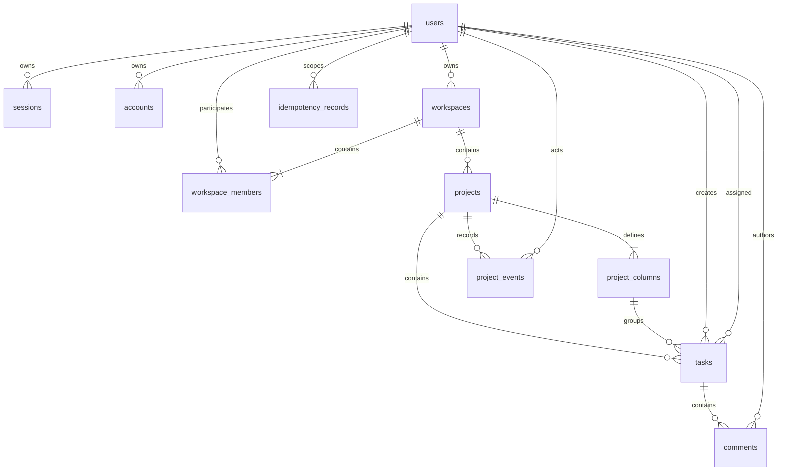

# SyncSpace — Data Model & Consistency Architecture

This document specifies the conceptual and relational data model, transaction isolation design, concurrency mechanisms, and sequence allocation for SyncSpace, based on [`SPECIFICATION.md`](SPECIFICATION.md).

---

## 1. Relational Schema & Entity Definitions

The authoritative data model consists of 9 core tables managed via Drizzle ORM and PostgreSQL:



---

### 1.1 `users`
Represents registered users in the system. Extended in Milestone 3 to support Better Auth authentication tables.
- `id UUID PRIMARY KEY DEFAULT gen_random_uuid()`
- `email CITEXT UNIQUE NOT NULL`
- `display_name TEXT NOT NULL`
- `email_verified BOOLEAN NOT NULL DEFAULT false`
- `image TEXT NULL`
- `created_at TIMESTAMPTZ NOT NULL DEFAULT now()`
- `updated_at TIMESTAMPTZ NOT NULL DEFAULT now()`

### 1.2 `workspaces`
The top-level multi-tenant boundary.
- `id UUID PRIMARY KEY DEFAULT gen_random_uuid()`
- `name TEXT NOT NULL`
- `owner_id UUID NOT NULL REFERENCES users(id)`
- `created_at TIMESTAMPTZ NOT NULL DEFAULT now()`
- `updated_at TIMESTAMPTZ NOT NULL DEFAULT now()`
- *(Note: Soft deletion via `deleted_at` is reserved for future versions; workspace deletion is out of scope for v1.)*

### 1.3 `workspace_members`
Enforces workspace membership and role authorization.
- `workspace_id UUID NOT NULL REFERENCES workspaces(id) ON DELETE CASCADE`
- `user_id UUID NOT NULL REFERENCES users(id) ON DELETE CASCADE`
- `role TEXT NOT NULL CHECK (role IN ('owner', 'admin', 'member'))`
- `joined_at TIMESTAMPTZ NOT NULL DEFAULT now()`
- **Primary Key:** `(workspace_id, user_id)`
- **Constraint Strategy:** Exactly one member per workspace has `role = 'owner'`, which must strictly agree with `workspaces.owner_id`.

### 1.4 `projects`
Collaborative boards owned by a workspace.
- `id UUID PRIMARY KEY DEFAULT gen_random_uuid()`
- `workspace_id UUID NOT NULL REFERENCES workspaces(id) ON DELETE CASCADE`
- `name TEXT NOT NULL`
- `archived_at TIMESTAMPTZ NULL`
- `last_seq BIGINT NOT NULL DEFAULT 0` — *Per-project monotonic event sequence counter.*
- `created_by UUID NOT NULL REFERENCES users(id)`
- `created_at TIMESTAMPTZ NOT NULL DEFAULT now()`
- `updated_at TIMESTAMPTZ NOT NULL DEFAULT now()`

### 1.5 `project_columns`
Fixed status columns defining workflow stages for a project.
- `id UUID PRIMARY KEY DEFAULT gen_random_uuid()`
- `project_id UUID NOT NULL REFERENCES projects(id) ON DELETE CASCADE`
- `name TEXT NOT NULL`
- `position INTEGER NOT NULL`
- **Constraints:** `UNIQUE (project_id, position)`, `UNIQUE (project_id, name)`
- **v1 Default Seed:** `Backlog` (position 0), `Todo` (position 1), `In Progress` (position 2), `Done` (position 3).

### 1.6 `tasks`
Individual work items on a project board.
- `id UUID PRIMARY KEY DEFAULT gen_random_uuid()`
- `project_id UUID NOT NULL REFERENCES projects(id) ON DELETE CASCADE`
- `column_id UUID NOT NULL REFERENCES project_columns(id)`
- `title TEXT NOT NULL`
- `description TEXT NOT NULL DEFAULT ''`
- `created_by UUID NOT NULL REFERENCES users(id)`
- `assignee_id UUID NULL REFERENCES users(id)`
- `rank_key TEXT NOT NULL` — *Fractional indexing key for ordering.*
- `version INTEGER NOT NULL DEFAULT 1` — *Optimistic concurrency version.*
- `due_date DATE NULL`
- `created_at TIMESTAMPTZ NOT NULL DEFAULT now()`
- `updated_at TIMESTAMPTZ NOT NULL DEFAULT now()`
- `archived_at TIMESTAMPTZ NULL`
- **Indexes:**
  - `CREATE INDEX idx_tasks_board ON tasks(project_id, column_id, rank_key, id);`
  - `CREATE INDEX idx_tasks_assignee ON tasks(project_id, assignee_id);`
  - `CREATE INDEX idx_tasks_search ON tasks USING GIN(tsv);` *(generated full-text vector)*

### 1.7 `comments`
Activity comments attached to active tasks.
- `id UUID PRIMARY KEY DEFAULT gen_random_uuid()`
- `task_id UUID NOT NULL REFERENCES tasks(id) ON DELETE CASCADE`
- `author_id UUID NOT NULL REFERENCES users(id)`
- `body TEXT NOT NULL`
- `created_at TIMESTAMPTZ NOT NULL DEFAULT now()`
- `deleted_at TIMESTAMPTZ NULL` — *Soft-deletion flag.*

### 1.8 `project_events`
The unified, append-only event stream, audit history, and catch-up feed.
- `id UUID PRIMARY KEY DEFAULT gen_random_uuid()`
- `project_id UUID NOT NULL REFERENCES projects(id) ON DELETE CASCADE`
- `seq BIGINT NOT NULL` — *Monotonically increasing contiguous sequence per project.*
- `actor_id UUID NOT NULL REFERENCES users(id)`
- `event_type TEXT NOT NULL` — *e.g., `task.created`, `task.moved`, `column.rebalanced`.*
- `entity_type TEXT NOT NULL` — *Must match event_type entity (e.g., `task`, `column`, `comment`, `project`).*
- `entity_id UUID NOT NULL`
- `payload JSONB NOT NULL` — *Canonical snapshot and diff metadata.*
- `created_at TIMESTAMPTZ NOT NULL DEFAULT now()`
- **Constraint:** `UNIQUE (project_id, seq)` — *Provides index for catch-up queries.*
- **Immutability:** Rows are append-only; updates and hard deletes are strictly prohibited.

### 1.9 `idempotency_records`
Ensures safe retry semantics for creation endpoints.
- `id UUID PRIMARY KEY DEFAULT gen_random_uuid()`
- `actor_id UUID NOT NULL REFERENCES users(id)`
- `endpoint_key TEXT NOT NULL` — *e.g., `tasks:create`, `comments:create`.*
- `idempotency_key TEXT NOT NULL`
- `request_hash TEXT NOT NULL` — *SHA-256 hash of method + resolved route + canonical JSON body.*
- `response_status INTEGER NOT NULL`
- `response_body JSONB NOT NULL`
- `created_at TIMESTAMPTZ NOT NULL DEFAULT now()`
- **Constraint:** `UNIQUE (actor_id, endpoint_key, idempotency_key)`
- **Retention:** Records are retained for at least 24 hours before cleanup.

### 1.10 `sessions`
Database-backed session storage for revocable user authentication sessions.
- `id UUID PRIMARY KEY DEFAULT gen_random_uuid()`
- `user_id UUID NOT NULL REFERENCES users(id) ON DELETE CASCADE`
- `token TEXT UNIQUE NOT NULL`
- `expires_at TIMESTAMPTZ NOT NULL`
- `ip_address TEXT NULL`
- `user_agent TEXT NULL`
- `created_at TIMESTAMPTZ NOT NULL DEFAULT now()`
- `updated_at TIMESTAMPTZ NOT NULL DEFAULT now()`
- **Indexes:** `UNIQUE (token)`, B-tree index on `user_id` (`idx_sessions_user_id`).

### 1.11 `accounts`
Stores authentication providers and credentials (including Argon2id password hashes for local email/password sign-in).
- `id UUID PRIMARY KEY DEFAULT gen_random_uuid()`
- `user_id UUID NOT NULL REFERENCES users(id) ON DELETE CASCADE`
- `account_id TEXT NOT NULL`
- `provider_id TEXT NOT NULL`
- `access_token TEXT NULL`
- `refresh_token TEXT NULL`
- `id_token TEXT NULL`
- `access_token_expires_at TIMESTAMPTZ NULL`
- `refresh_token_expires_at TIMESTAMPTZ NULL`
- `scope TEXT NULL`
- `password TEXT NULL`
- `created_at TIMESTAMPTZ NOT NULL DEFAULT now()`
- `updated_at TIMESTAMPTZ NOT NULL DEFAULT now()`
- **Indexes:** B-tree index on `user_id` (`idx_accounts_user_id`).

### 1.12 `verifications`
Stores time-limited verification tokens for email verification and password resets.
- `id UUID PRIMARY KEY DEFAULT gen_random_uuid()`
- `identifier TEXT NOT NULL`
- `value TEXT NOT NULL`
- `expires_at TIMESTAMPTZ NOT NULL`
- `created_at TIMESTAMPTZ NOT NULL DEFAULT now()`
- `updated_at TIMESTAMPTZ NOT NULL DEFAULT now()`
- **Indexes:** B-tree index on `identifier` (`idx_verifications_identifier`).

---

## 2. Consistency & Transaction Architecture

### 2.1 Transaction Isolation: PostgreSQL `READ COMMITTED`
All mutations run under PostgreSQL's default `READ COMMITTED` isolation level. Domain operations are explicitly designed to prevent race conditions without requiring global serializable isolation:
1. **Explicit Row Locks:** Mutations lock specific rows (`SELECT ... FOR UPDATE`) in a deterministic order.
2. **Atomic Co-Commit:** Domain changes, event insertion, sequence increment, and idempotency records commit together in a single transaction.

---

### 2.2 Sequence Allocation Mechanics
Event sequences are allocated by acquiring an exclusive lock on the project's sequence counter:
```sql
-- Inside the mutation transaction:
SELECT last_seq FROM projects WHERE id = :project_id FOR UPDATE;

UPDATE projects 
SET last_seq = last_seq + 1, updated_at = now() 
WHERE id = :project_id;

INSERT INTO project_events (id, project_id, seq, actor_id, event_type, entity_type, entity_id, payload)
VALUES (gen_random_uuid(), :project_id, :new_seq, :actor_id, :event_type, :entity_type, :entity_id, :payload);

PERFORM pg_notify('project_events', json_build_object('projectId', :project_id, 'seq', :new_seq)::text);
```
Holding the row lock until transaction commit guarantees that the next transaction for that project cannot allocate a sequence until the current transaction commits or rolls back, preventing sequence gaps or out-of-order commitments.

---

### 2.3 Fractional Indexing & Automatic Rebalancing
- **Ordering Representation:** Tasks in each column are sorted by `rank_key ASC, id ASC`.
- **Rank Key Generation:** When moving a task between Task A (rank $R_A$) and Task B (rank $R_B$), the server generates $R_{new} = \text{midpoint}(R_A, R_B)$.
- **Rebalance Trigger:** If the computed $R_{new}$ length exceeds 32 characters:
  1. The transaction locks all active tasks in that column.
  2. Generates evenly spaced, compact rank keys (e.g., `a0`, `a1`, `a2`, ...) preserving the exact visible order.
  3. Inserts a `column.rebalanced` event containing the `{ task_id, rank_key }` map with sequence $S$.
  4. Applies the triggering move with sequence $S + 1$.
  5. Individual task versions are **not** incremented by a rebalance.

---

### 2.4 Event Payload Rules
- **Task Events (`task.*`):** Carry the complete after-state task snapshot (including `version`) and a `changes` object:
  ```json
  {
    "task": {
      "id": "...",
      "projectId": "...",
      "columnId": "...",
      "title": "Updated Title",
      "version": 4,
      "rankKey": "a0V",
      ...
    },
    "changes": {
      "title": { "from": "Old Title", "to": "Updated Title" }
    }
  }
  ```
  *(For descriptions, `changes` contains `{ "description": { "changed": true } }`; raw description text is never stored in diffs.)*
- **Comment Events (`comment.*`):** Contain IDs and metadata only (`commentId`, `taskId`, `authorId`, `deletedAt`). Comment bodies are **never** included in event payloads to maintain privacy and audit hygiene.

