# SyncSpace — Rollback Principles & Operational Recovery

This document establishes the safe rollback principles, multi-layer reversal strategies, and disaster recovery procedures for SyncSpace, based on [`SPECIFICATION.md`](SPECIFICATION.md) and [`../AGENTS.md`](../AGENTS.md).

---

## 1. Core Rollback Principles

1. **Audit Log Immutability:** The `project_events` table is append-only. Normal operational rollbacks must never rewrite, reorder, or delete committed event history.
2. **Atomic Rollback by Default:** Every domain mutation is enclosed in a database transaction. If any precondition, constraint, or event insertion fails, the entire transaction rolls back cleanly with zero persistent side effects.
3. **Non-Destructive Schema Evolution:** Database migrations must be forward-compatible. Never drop columns, alter data types destructively, or rename active tables in a single deployment step.
4. **Preserve User Intent:** Client-side optimistic UI rollbacks must never discard unsaved user input. If an update fails due to a conflict (`409 VERSION_CONFLICT`), form text must be retained in place.

---

## 2. Multi-Layer Reversal & Rollback Mechanisms

```mermaid
flowchart TD
    subgraph Layer1["Layer 1: Database Transactions"]
        TxFail["Constraint / Version Failure"] -->|ACID Rollback| TxAbort["0 Rows Changed, 0 Events Emitted"]
    end

    subgraph Layer2["Layer 2: Client Optimistic UI"]
        HTTPError["HTTP 409 / Network Drop"] -->|Revert Local State| UIRollback["Restore Previous Snapshot + Keep Form Text"]
    end

    subgraph Layer3["Layer 3: Schema Migrations"]
        MigrationIssue["Defective Migration"] -->|Expand / Contract Pattern| SafeMigration["Backward-Compatible Drizzle Migrations"]
    end

    subgraph Layer4["Layer 4: Application Code Deployment"]
        DeployIssue["Bad Code Release"] -->|Container Rollback| PriorRelease["Redeploy Previous Git Commit"]
    end
```

---

### 2.1 Transaction-Level Rollback (PostgreSQL ACID)
- **Scope:** Runtime failures during mutation execution (e.g., stale `expectedVersion`, foreign key failure, check constraint violation).
- **Behavior:**
  - PostgreSQL automatically aborts all uncommitted writes.
  - No domain records (tasks, comments, columns) are updated.
  - The project sequence counter (`projects.last_seq`) is restored to its pre-transaction value; no sequence gap is created.
  - No `project_events` row is persisted.
  - No `NOTIFY` signal is delivered across PostgreSQL notification channels.
- **Verification:** Tested in the PostgreSQL integration test suite by deliberately injecting errors prior to commit.

---

### 2.2 Client-Side Optimistic UI Rollback
- **Scope:** Browser UI state when an optimistic action (drag-and-drop or task edit) is rejected by the server.
- **Behavior:**
  - Before applying an optimistic visual update, the client stores a snapshot of the affected task/column state.
  - Upon receiving an error response (such as `409 VERSION_CONFLICT` or `500 INTERNAL_ERROR`):
    1. The visual card or column reverts immediately to the pre-mutation snapshot.
    2. Active form inputs (e.g., title, description) retain the user's typed modifications without overwriting them with server data.
    3. A non-blocking notification displays the failure reason and prompts the user to refresh or reapply their edit.

---

### 2.3 Database Migration Rollback Strategy
- **Philosophy:** Expand-and-contract (two-phase migrations) over hard rollback scripts.
- **Guidelines for Schema Changes:**
  - **Adding Columns:** Add new columns as nullable or with safe defaults. Application code is deployed second.
  - **Deprecating Columns:** Stop reading/writing the column in code first; drop the column in a subsequent release after verifying no active dependencies exist.
  - **Drizzle Migration Discipline:** Drizzle migrations must be versioned, committed to Git, and tested against a replica database before deployment to production.
  - **Emergency Down Migrations:** If a down migration is strictly necessary, it must be reviewed and tested in an isolated environment to ensure no foreign keys or data cascades are triggered destructively.

---

### 2.4 Application Code Rollback
- **Decoupled Deployments:** Frontend (Next.js) and backend (Node.js) are decoupled services.
- **Backward Compatibility:** Backend API endpoints and event payloads must remain backward-compatible with older client versions. A rollback of the backend to the previous container image must not break connected frontend clients or corrupt database state.

---

## 3. Disaster Recovery & Areas Requiring Implementation-Specific Procedures

The following scenarios describe edge-case operational recoveries that must be formalized when infrastructure and deployment tooling are finalized:

### OPEN QUESTION 1: Database Point-in-Time Recovery (PITR) & Sequence Resynchronization
- **Scenario:** A catastrophic hardware or database failure requires restoring PostgreSQL from a point-in-time backup.
- **Problem:** Restoring to a timestamp 10 minutes prior rolls back `projects.last_seq` and `project_events`. Connected clients whose local cursors are ahead of the restored database will fail catch-up queries or reject replayed events.
- **Required Procedure (To be developed):**
  - Define an explicit reset protocol: if `GET /api/projects/:projectId/changes?after=<seq>` receives a sequence higher than the database's current `last_seq`, the server returns a documented reset error (`410 CURSOR_RESET`).
  - Clients catching this error must discard their local event buffer and reload a fresh board snapshot in a `REPEATABLE READ` transaction.

---

### OPEN QUESTION 2: Rank-Key Desynchronization Recovery
- **Scenario:** A software defect or anomalous concurrent move generates corrupted or duplicate rank keys within a column.
- **Required Procedure (To be developed):**
  - Implement an administrative rebalance command (`POST /api/projects/:projectId/columns/:columnId/rebalance-force`) that normalizes all keys and emits a corrective `column.rebalanced` event without losing tasks.

---

### OPEN QUESTION 3: Automated Migration Rollback Verification in CI/CD
- **Scenario:** Ensuring migration scripts are reversible before merging.
- **Required Procedure (To be developed):**
  - Configure CI pipeline to execute migrations up, apply rollbacks down, and re-apply up against a real PostgreSQL container to guarantee migration script reversibility.

