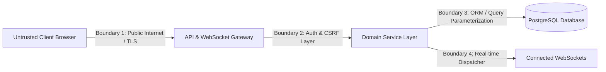

# SyncSpace — Threat Model & Security Architecture

This document outlines the threat modeling boundaries, potential attack vectors, trust assumptions, and required security protections for SyncSpace, based on [`SPECIFICATION.md`](SPECIFICATION.md) and [`../AGENTS.md`](../AGENTS.md).

---

## 1. Trust Boundaries & Security Architecture

SyncSpace operates across five critical trust boundaries:

1. **Boundary 1 (Client to Gateway):** Public internet traffic. All client inputs, headers, and parameters are untrusted and potentially malicious.
2. **Boundary 2 (Gateway to Service Layer):** Authenticated sessions. Validates user identity and session validity before admitting requests to domain handlers.
3. **Boundary 3 (Service Layer to Database):** All authorization (tenant boundaries and role capabilities) is resolved here. Input data is passed exclusively through parameterized SQL queries.
4. **Boundary 4 (Database to Real-Time Dispatcher):** PostgreSQL `NOTIFY` and events. Payloads are checked against database authorization before being dispatched to client sockets.

---

## 2. Threat Analysis & Mitigations

### 2.1 Cross-Workspace Tenant Data Leakage (IDOR)
- **Threat:** An authenticated attacker in Workspace A attempts to access, mutate, search, or subscribe to projects, tasks, or comments in Workspace B by guessing or harvesting UUIDs.
- **Impact:** Critical breach of confidentiality and integrity in a multi-tenant environment.
- **Required Protections:**
  - Client-supplied resource IDs are **never** trusted as proof of authorization.
  - Every API endpoint and WebSocket subscription resolves the resource's parent workspace ID and verifies the actor's membership in `workspace_members`.
  - Unauthorized requests must return `404 NOT_FOUND` rather than `403 FORBIDDEN` to prevent attackers from determining whether a specific UUID exists.
  - Automated cross-workspace test suites must run for every resource category (workspaces, members, projects, columns, tasks, comments, events, search, and WebSockets).

---

### 2.2 Privilege Escalation within a Workspace
- **Threat:** A standard `Member` attempts to invite new members, change roles, rename projects, or archive the workspace; or an `Admin` attempts to demote or remove the `Owner`.
- **Impact:** Unauthorized administrative control and hostile workspace takeover.
- **Required Protections:**
  - Server-side role checks in the service layer against the permission matrix.
  - Strict database rule: Admins cannot demote or remove the Owner.
  - Ownership transfer is restricted to the current Owner and executes in a single transaction that updates `workspaces.owner_id` and the two corresponding `workspace_members.role` records simultaneously.

---

### 2.3 Cross-Site Request Forgery (CSRF)
- **Threat:** A malicious third-party website tricks an authenticated user's browser into submitting state-changing HTTP requests (e.g., deleting comments or creating tasks) using ambient session cookies.
- **Impact:** Unauthorized state mutations performed on behalf of legitimate users.
- **Required Protections:**
  - Use secure, `HttpOnly` cookies with `SameSite=Lax` (or `Strict`) in production.
  - Validate the `Origin` header on all mutation requests.
  - Require anti-CSRF synchronizer tokens or double-submit cookies on all state-changing endpoints.

---

### 2.4 Cross-Site WebSocket Hijacking (CSWSH) & Unauthorized Subscriptions
- **Threat:** A malicious website opens a WebSocket connection to SyncSpace using an authenticated victim's browser cookies to snoop on project event streams.
- **Impact:** Real-time data exfiltration of tasks, assignments, and board activity.
- **Required Protections:**
  - Strict WebSocket handshake validation: check the `Origin` header against an explicit allowed-origins whitelist. Reject non-matching origins immediately.
  - Authenticate user session cookies before completing the WebSocket handshake.
  - Re-verify workspace membership directly against PostgreSQL before subscribing a socket to any project channel.

---

### 2.5 Stale-Write & Race Condition Exploitation
- **Threat:** An attacker reads a task, waits for another user to modify it (e.g., changing status or assignee), and submits an outdated write to overwrite the newer state.
- **Impact:** Silent data corruption and lost updates.
- **Required Protections:**
  - Mandatory `expectedVersion` parameter on task field edits and moves.
  - Server enforces conditional update or row-level lock verifying `expectedVersion == version`.
  - Stale mutations are rejected with `409 VERSION_CONFLICT` and return the authoritative current task state.

---

### 2.6 Duplicate Mutation Flooding & Replay Attacks
- **Threat:** Network timeouts or malicious replays cause duplicate task or comment creation requests to reach the server.
- **Impact:** Duplicate entries cluttering the project board and artificial inflation of project event sequences.
- **Required Protections:**
  - Mandatory `Idempotency-Key` header on task creation and comment creation.
  - Scoped to `(actor_id, endpoint_key, idempotency_key)`.
  - Compares the SHA-256 `request_hash` (HTTP method + resolved path + canonical JSON body).
  - Identical requests return the original cached response; conflicting request hashes return `409 IDEMPOTENCY_KEY_REUSED`.

---

### 2.7 SQL Injection
- **Threat:** Malicious SQL statements injected via request parameters, search queries, or JSON payloads.
- **Impact:** Complete database compromise or data exfiltration.
- **Required Protections:**
  - All database interactions use Drizzle ORM parameterized queries.
  - Full-text search queries sanitize user input and use parameterized vector matching (`plainto_tsquery` or `websearch_to_tsquery`).
  - Raw SQL string concatenation is strictly forbidden.

---

### 2.8 Brute Force & Credential Enumeration
- **Threat:** Attackers execute credential stuffing against login routes or probe member invitation endpoints to enumerate registered user emails.
- **Impact:** Account takeover and user privacy violation.
- **Required Protections:**
  - Argon2id password hashing via Better Auth.
  - Rate limiting on authentication routes and member invitation endpoints.
  - The member invitation endpoint (`POST /api/workspaces/:id/members`) returns a generic response that does not disclose whether the email is already registered or already belongs to the workspace.

---

### 2.9 Zombie Connections & Revocation Lag
- **Threat:** A user is removed from a workspace or demoted, but their existing WebSocket connection continues to receive confidential project events.
- **Impact:** Former members retain real-time access to private workspace updates.
- **Required Protections:**
  - Membership changes (removal or role modification) emit a notification on the dedicated PostgreSQL channel `membership_changes` in the same transaction.
  - Every application instance listens on `membership_changes` and immediately re-evaluates or terminates affected client WebSockets.
  - Prior to delivering any event to a local socket, the dispatcher queries PostgreSQL directly to confirm active membership. No in-memory permission cache is permitted in v1.

---

### 2.10 Information Disclosure in Logs & Error Envelopes
- **Threat:** Application logs or error responses expose database connection strings, passwords, session tokens, stack traces, or deleted comment contents.
- **Impact:** Credential leakage and violation of user privacy.
- **Required Protections:**
  - Structured JSON logging with automated redaction of sensitive headers, passwords, cookies, and tokens.
  - Standardized error envelope (`code`, `message`, `details`, `requestId`); stack traces and raw SQL errors are stripped in non-development environments.
  - Comment event payloads (`comment.created`, `comment.deleted`) contain IDs and metadata only—**never** comment bodies.

